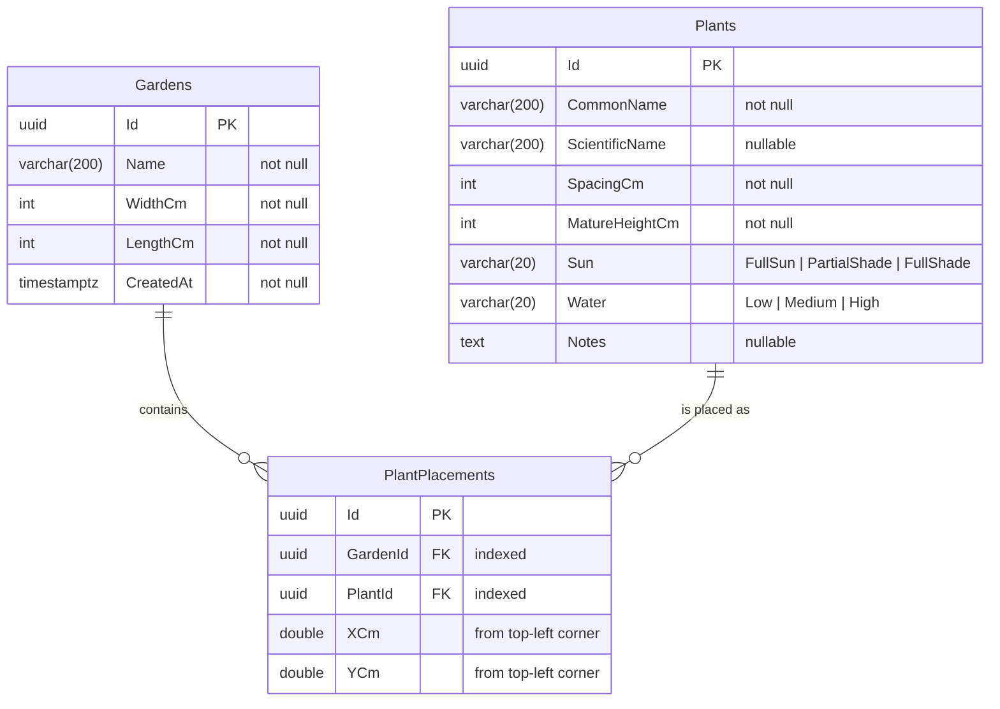

# ER Diagram

Current database schema (PostgreSQL), generated by the EF Core migration
`20260929115905_InitialCreate`.

## Notes

- **Gardens → PlantPlacements:** deleting a garden deletes its placements (cascade).
- **Plants → PlantPlacements:** also cascade at the moment. Deleting a catalogue plant would
  silently remove it from every garden. Consider `Restrict` once plant management exists.
- Enums (`Sun`, `Water`) are stored as strings, so the database stays readable.
- All sizes and positions are in centimetres; the frontend converts to pixels.
