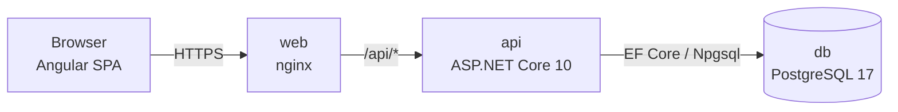
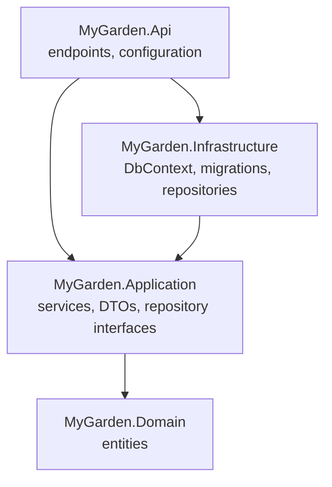
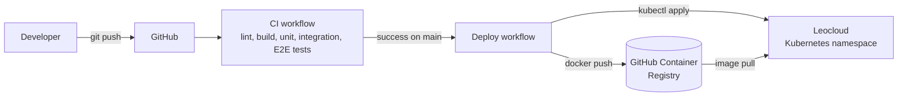

# Project Design – MyGarden

## Overview

MyGarden is a single-page web application. An Angular frontend talks to a REST API
(ASP.NET Core Minimal API), which stores its data in PostgreSQL through Entity Framework Core.
All parts run in containers: locally with Docker Compose, in production on Leocloud (Kubernetes).

## Technology decisions

| Area | Choice | Reason |
|---|---|---|
| Backend | ASP.NET Core 10 Minimal API | Required/preferred technology from POSE classes; little boilerplate for a REST API |
| Data access | Entity Framework Core 10 + Npgsql | Preferred technology; migrations keep the schema in the repository |
| Database | PostgreSQL 17 | Preferred technology; free, runs well in containers |
| Frontend | Angular 22 (standalone components, signals) | Required |
| Canvas | Konva | Canvas library with drag and drop, layers and hit detection |
| Unit tests | xUnit (backend), Vitest (frontend) | |
| Integration tests | xUnit + Testcontainers | Tests run against a real PostgreSQL, including all migrations |
| E2E tests | Playwright | Tests the full stack in a real browser |
| System tests | Markdown list ([system-tests.md](system-tests.md)) | Simple, versioned with the code |
| CI/CD | GitHub Actions | Required |
| Hosting | Leocloud (Kubernetes), images in GitHub Container Registry | Required/offered by the school |

## Backend architecture

The backend uses a layered ("clean") architecture. Dependencies only point inwards:

- **Domain** – entities (`Garden`, `Plant`, `PlantPlacement`), no dependencies.
- **Application** – use-case logic and validation (`GardenService`), DTOs, and interfaces
  such as `IGardenRepository`. Unit-tested without a database.
- **Infrastructure** – implements the interfaces with EF Core.
- **Api** – maps HTTP endpoints to services, configures dependency injection.

## REST API

Base path: `/api`. Errors use RFC 9457 problem details.

| Method | Path | Description | Responses |
|---|---|---|---|
| GET | `/api/health` | Health check (used by Kubernetes probes and CI) | 200 |
| GET | `/api/gardens` | All gardens, sorted by name | 200 |
| GET | `/api/gardens/{id}` | One garden | 200, 404 |
| POST | `/api/gardens` | Create a garden `{ name, widthCm, lengthCm }` | 201, 400 |

Planned: `PUT`/`DELETE` for gardens, `/api/plants`, `/api/gardens/{id}/placements`.
The OpenAPI document is available at `/openapi/v1.json` in development.

## Frontend structure

| Folder | Content |
|---|---|
| `core/` | API clients, HTTP interceptors |
| `features/gardens/` | Garden list and creation form |
| `features/canvas/` | Konva garden editor |
| `shared/models/` | TypeScript interfaces matching the API DTOs |

Routes: `/` (garden list), `/gardens/:id` (canvas). In development, `ng serve` proxies `/api`
to the backend; in containers, nginx does the same.

## Data model

See [er-diagram.md](er-diagram.md). Sizes and positions are stored in centimetres; the canvas
scales them to pixels so the garden fits the screen.

## Deployment

- The API applies pending EF Core migrations on startup (`Database:MigrateOnStartup`).
- Kubernetes manifests: [`k8s/`](../k8s). Setup steps: see the main [README](../README.md#deployment-leocloud).

## Quality measures

- Code style enforced by `.editorconfig` and `dotnet format` in CI.
- Every push runs all automated tests (unit, integration, E2E).
- System tests are run manually before every sprint review.
