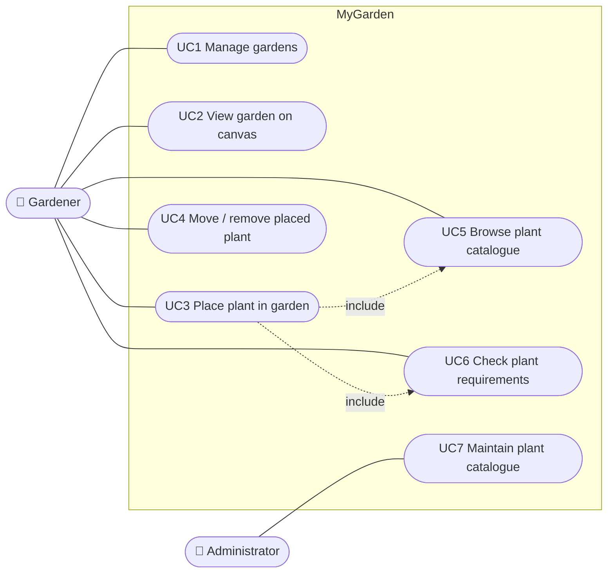

# Use Cases

Status: ✅ implemented · 🟡 partly implemented · ⬜ planned

## Actors

| Actor | Description |
|---|---|
| Gardener | Main user. Plans gardens and places plants. |
| Administrator | Maintains the plant catalogue. **TODO** decide whether this role is needed or the gardener does it. |

## Use case diagram

## UC1 – Manage gardens 🟡

| | |
|---|---|
| Actor | Gardener |
| Goal | Create, rename, resize and delete gardens. |
| Precondition | – |
| Main flow | 1. Gardener opens the garden list. 2. Enters name, width and length (cm). 3. Clicks "Create garden". 4. System validates the input and shows the new garden in the list. |
| Alternative flows | 2a. Name empty or size ≤ 0 → system shows a validation error. |
| Postcondition | Garden is stored. |
| Status | Create and list are implemented; edit and delete are planned. |

## UC2 – View garden on canvas 🟡

| | |
|---|---|
| Actor | Gardener |
| Goal | See the garden to scale with a 50 cm grid and all placed plants. |
| Precondition | Garden exists. |
| Main flow | 1. Gardener selects a garden in the list. 2. System loads the garden and draws it scaled to the screen width. 3. System draws all placed plants as circles sized by their spacing. |
| Status | Garden and grid are drawn; placed plants are not loaded yet (placeholder plant only). |

## UC3 – Place plant in garden ⬜

| | |
|---|---|
| Actor | Gardener |
| Goal | Add a plant from the catalogue to a position in the garden. |
| Precondition | Garden is open on the canvas. |
| Main flow | 1. Gardener chooses a plant from the catalogue (UC5). 2. Drags it onto the canvas. 3. System stores the position in cm. 4. System checks spacing to neighbouring plants (UC6). |
| Alternative flows | 2a. Dropped outside the garden → placement is rejected. 4a. Too close to another plant → warning is shown, placement is still allowed. |
| Postcondition | Placement is stored. |

## UC4 – Move / remove placed plant ⬜

| | |
|---|---|
| Actor | Gardener |
| Goal | Correct a plan by moving or removing plants. |
| Main flow | 1. Gardener drags a placed plant to a new position, or selects it and chooses "Remove". 2. System stores the change and re-checks spacing. |

## UC5 – Browse plant catalogue ⬜

| | |
|---|---|
| Actor | Gardener |
| Goal | Find a plant and read its care data (spacing, height, sun, water, notes). |
| Main flow | 1. Gardener opens the catalogue. 2. Searches or filters (e.g. by sun exposure). 3. Opens a plant to see its details. |

## UC6 – Check plant requirements ⬜

| | |
|---|---|
| Actor | Gardener (included in UC3/UC4) |
| Goal | Be warned about plants that are too close or have conflicting needs. |
| Main flow | 1. System compares the distance between placements with the plants' spacing. 2. Marks conflicting plants on the canvas and lists the reason. |

## UC7 – Maintain plant catalogue ⬜

| | |
|---|---|
| Actor | Administrator |
| Goal | Add, edit and delete plants and their care data. |
| Alternative flows | Deleting a plant that is placed in a garden → **TODO** decide: block or remove placements (see [ER diagram notes](er-diagram.md#notes)). |
